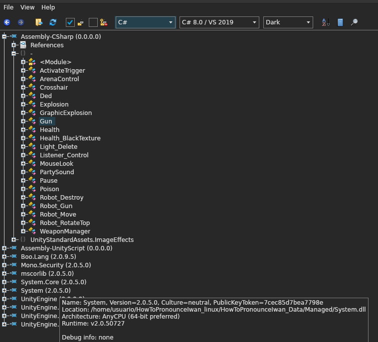
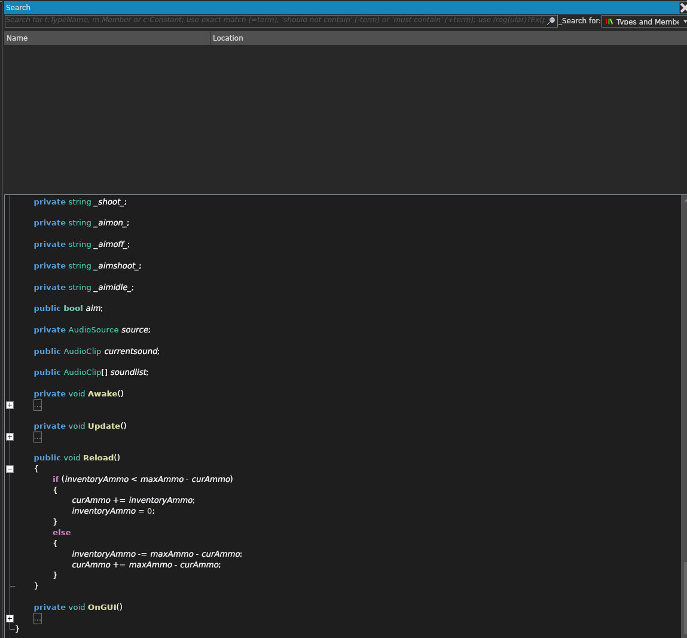
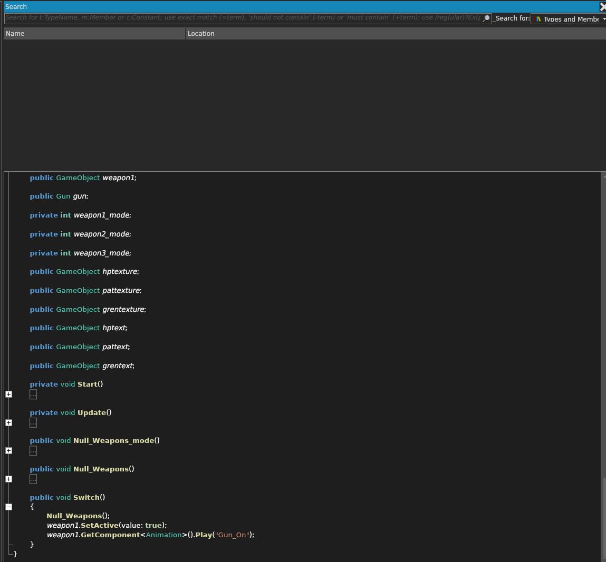
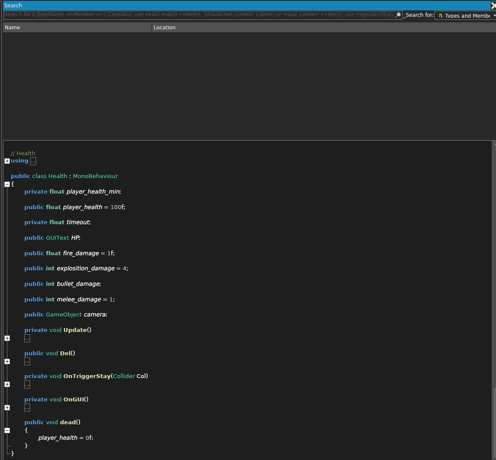
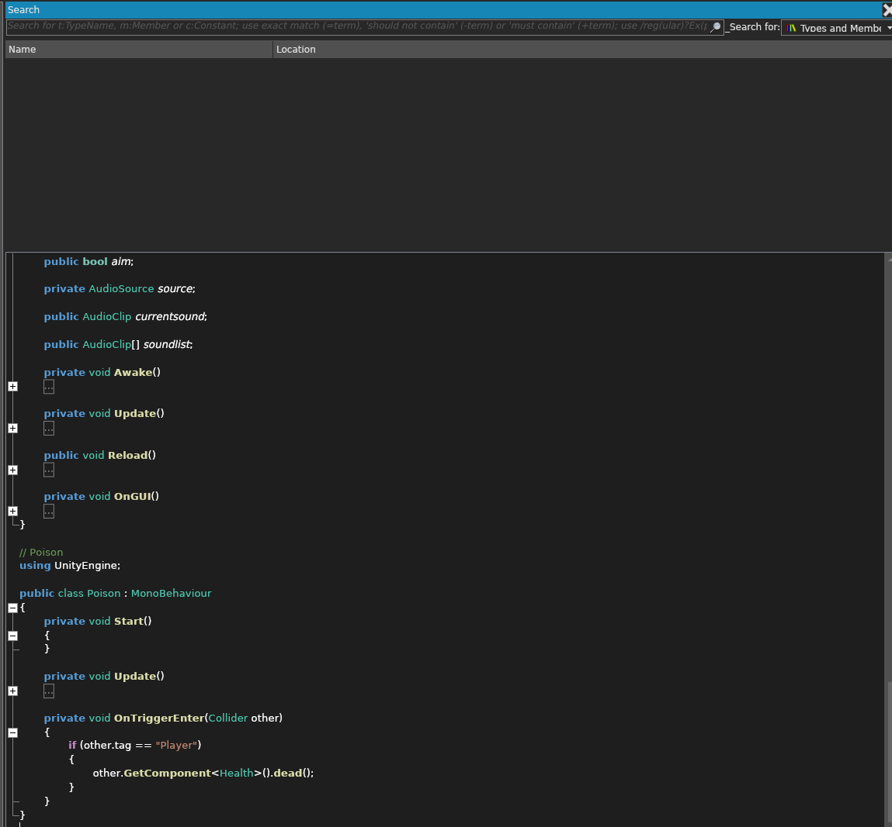
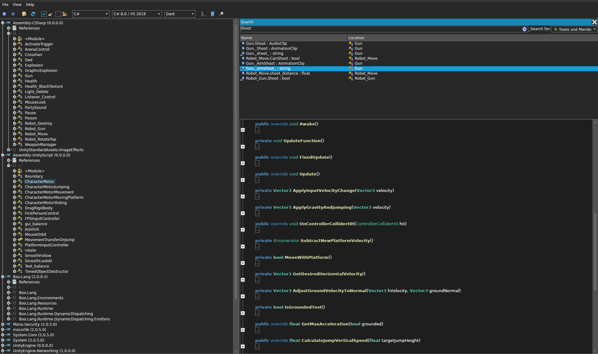
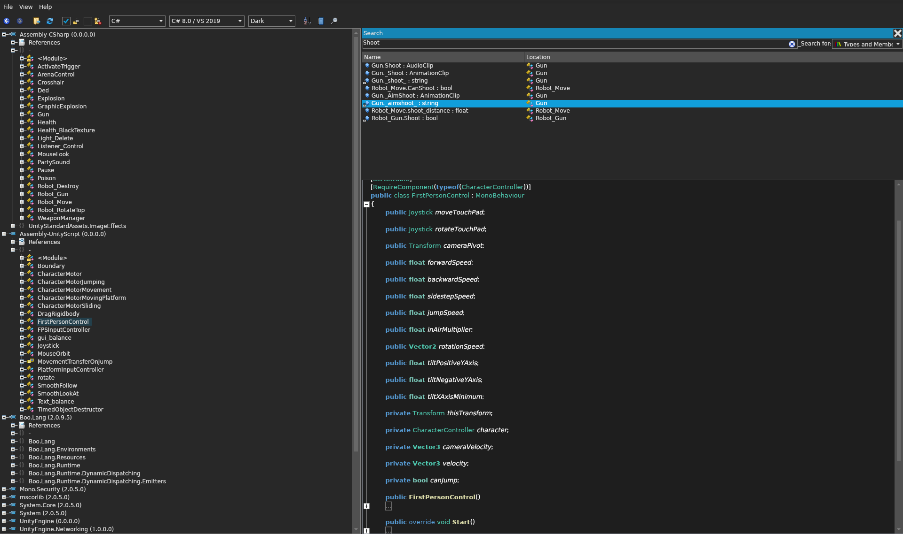
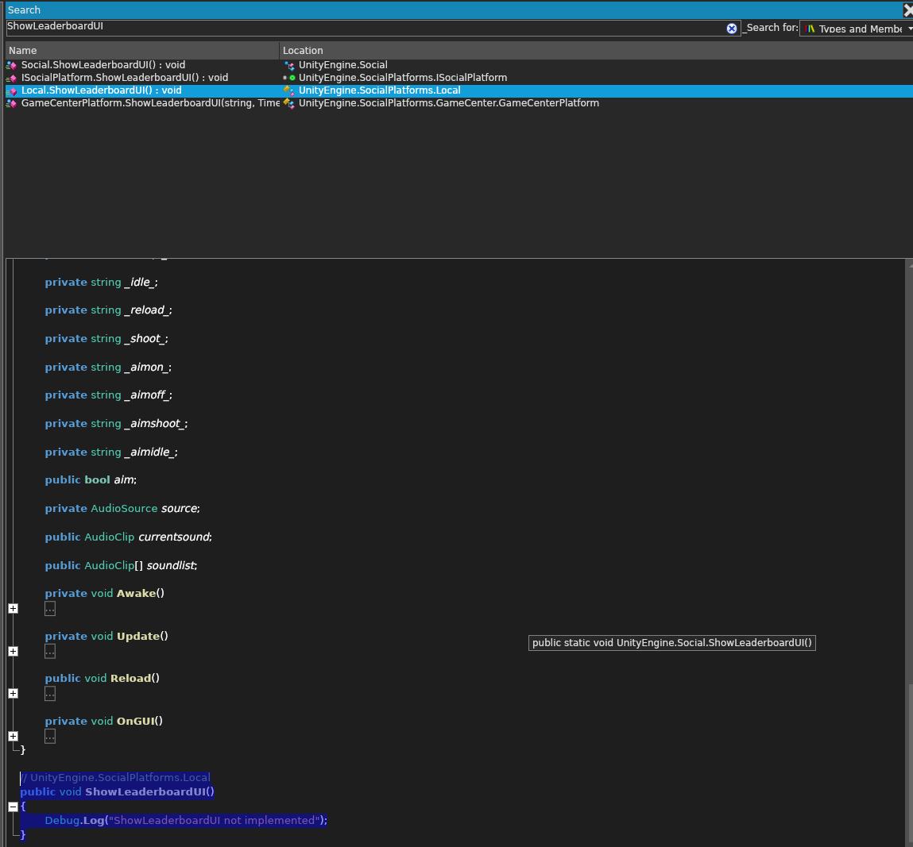

# How to Pronounce Iwan: Reverse-Engineering Notes

## Overview

- Game files: [How to Pronounce Iwan on itch.io](https://iwanplays.itch.io/iwan)
- Engine: Unity
- Game type: Arena combat
- Networking: No active networking has been confirmed
- Save location: Unknown

The assembly browser shows game classes including `ArenaControl`, `Explosion`, `Gun`, `Health`, `Poison`, `Robot_Gun`, `Robot_Move`, and `WeaponManager`.

## Systems

### Weapons and combat

- The player selects weapons with a scroll-wheel weapon roulette.
- The player can carry up to three weapons and starts with none.
- `WeaponManager` handles weapon selection and switching. The screenshot shows weapon slots and a `Switch()` method.
- `Gun` contains weapon behavior, including a `Reload()` method that transfers ammunition between the current and reserve ammo values.
- Guns and enemy guns have separate classes.
- Combat takes place in an arena, and the game includes explosions.

### Player health and damage

- The `Health` class tracks player health and damage values.
- Observed damage sources include bullets, melee, explosions, and poison.
- The screenshot shows initial health of 100, explosion damage of 4, melee damage of 1, and fire damage of 1. The bullet damage value is not initialized in the visible code.
- `Poison` checks for the `Player` tag and calls `Health.dead()`, which sets player health to zero. This appears to be an instant kill rather than gradual poison damage.

### Movement

- `CharacterMotor` requires a `CharacterController`; movement runs in `FixedUpdate` by default (`useFixedUpdate` switches to `Update`). Inputs: `inputMoveDirection`, `inputJump`.
- `CharacterMotorMovement`, `CharacterMotorJumping`, `CharacterMotorMovingPlatform`, and `CharacterMotorSliding` hold movement settings and state.
- Separate ground/air acceleration; gravity capped by `maxFallSpeed`; ground speed adjusts to slope.
- Jump input is buffered for 0.2 seconds. Holding jump extends jump height; steep slopes change jump direction. Jump calls `OnJump` and plays an attached `AudioSource`.
- Steep slopes can slide. Moving platforms track and transfer platform velocity according to `movementTransfer`.
- Ground transitions send `OnFall` / `OnLand`; `SetVelocity()` sends `OnExternalVelocity`.

#### FirstPersonControl

- Separate `CharacterController`-based controller; attachment alongside `CharacterMotor` is unverified. Spawns at `PlayerSpawn` when present.
- Requires `moveTouchPad` and `cameraPivot`; `rotateTouchPad` is optional. Movement/jump defaults: forward 4, backward/sideways 1, jump 8, air control 0.25.
- Double-tap the active joystick to jump; release before jumping again. Look uses `rotateTouchPad` or device tilt and updates only while grounded.
- `OnEndGame()` disables the joysticks and controller.
- Possible double gravity while airborne: gravity updates vertical velocity and is also added to motion. Verify in-game.

### User, achievements, and leaderboards

- User, achievement, and leaderboard systems are present or referenced in the game.
- A local leaderboard method exists, but `Local.ShowLeaderboardUI()` logs `ShowLeaderboardUI not implemented`.
- In the local playthrough, leaderboard points are not saved and the UI shows no leaderboard data.

## Persistence and networking

- No active networking has been confirmed in the inspected gameplay code.
- The local leaderboard implementation is incomplete.
- Where user, achievement, and other game data are stored is unknown; do not assume it is saved locally until the save code or files are located.

## Open questions

- Where does the game save local user and achievement data, if anywhere?
- Are any networking or platform-service APIs called during normal gameplay?
- Is the three-weapon limit enforced by `WeaponManager` or by another component?
- How is bullet damage assigned, and which classes apply it?
- Is poison intended to kill immediately, or is the observed call a bug?
- Which enemy classes and arena systems control spawning and combat flow?